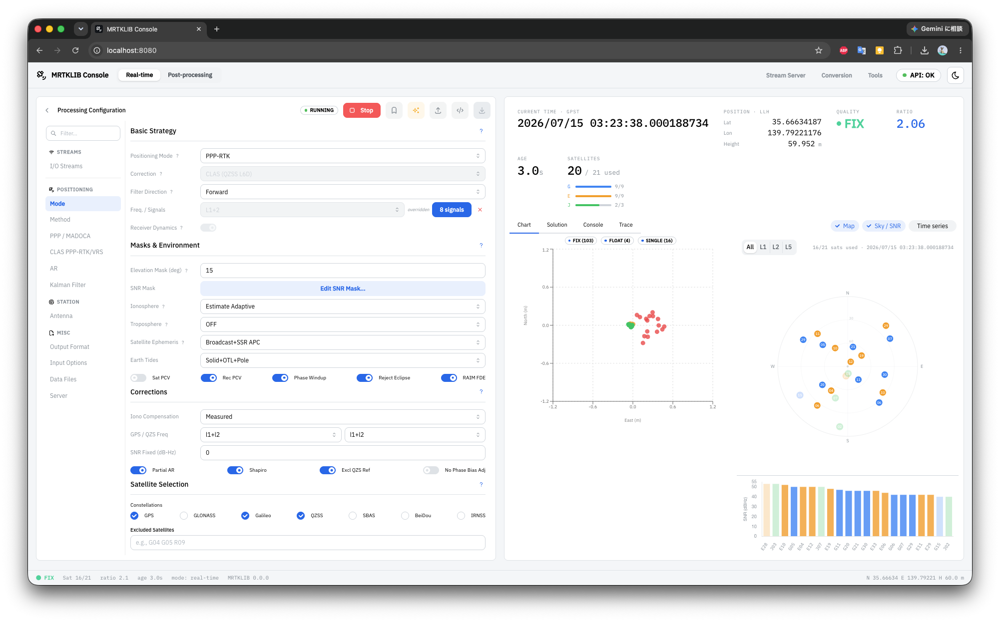

# MRTKLIB Web UI

A web user interface for [MRTKLIB](https://github.com/h-shiono/MRTKLIB),
running entirely in a Docker container. MRTKLIB is a modernized C11
implementation of RTKLIB with MADOCA-PPP, CLAS PPP-RTK, and advanced
GNSS positioning capabilities. No compilation required — just
`docker compose up` and start processing GNSS data from your browser.


> **Status**: v0.4.9-alpha — core features are functional.
> Known limitations are listed in
> [Known issues and test status](https://h-shiono.github.io/mrtklib-docker-ui/reference/known-issues/).



**Documentation: <https://h-shiono.github.io/mrtklib-docker-ui/>**

## What it does

- **Real-time** positioning with `mrtk run`, from receiver, NTRIP and
  correction streams (CLAS, MADOCA, Galileo HAS, BeiDou PPP-B2b, SouthPAN
  PVS, IGS-RTS), with live position, map, sky plot and SNR.
- **Post-processing** with `mrtk post`, every MRTKLIB option in one form,
  TOML import / export and presets, and a Result Viewer.
- **Streams**: relay and save streams with `mrtk relay`, configure
  Septentrio and u-blox receivers, and run CLAS to RTCM3.
- **Monitor**: decode a receiver or stream live (NMEA, SBF, UBX).
- **Tools**: RINEX conversion, Hatanaka compression, GNSS time converter,
  data downloader.

The [Screens](https://h-shiono.github.io/mrtklib-docker-ui/screens/) pages
describe each one. For a first run, see
[mrtklib-quickstart](https://github.com/h-shiono/mrtklib-quickstart). For
what the options mean, see the
[MRTKLIB documentation](https://h-shiono.github.io/MRTKLIB/).

## Quick start

Images are published for `linux/amd64` and `linux/arm64` on
[Docker Hub](https://hub.docker.com/r/hatognss/mrtklib-docker-ui) and
[GHCR](https://github.com/h-shiono/mrtklib-docker-ui/pkgs/container/mrtklib-docker-ui).

```bash
mkdir -p ./workspace ./data   # put your GNSS data under ./data
docker run -d --name mrtklib-web-ui \
  -p 127.0.0.1:8080:8000 \
  -v "$(pwd)/workspace:/workspace:rw" \
  -v "$(pwd)/data:/data:ro" \
  -e PUID="$(id -u)" -e PGID="$(id -g)" \
  hatognss/mrtklib-docker-ui:0.4.9-alpha
```

Open <http://localhost:8080>. The UI answers on this computer only.

- [Install](https://h-shiono.github.io/mrtklib-docker-ui/getting-started/install/):
  Docker Compose and building from source.
- [Serial devices](https://h-shiono.github.io/mrtklib-docker-ui/getting-started/serial/):
  connecting a receiver, also on macOS and Windows.
- [Security and network access](https://h-shiono.github.io/mrtklib-docker-ui/deployment/security/):
  read this before opening the UI to another machine.

## Contributing

Bug reports, feature requests and pull requests are welcome. Real-world
testing with your own receiver or data set helps most: if something does
not work as expected, please
[open an issue](https://github.com/h-shiono/mrtklib-docker-ui/issues).
See [CONTRIBUTING.md](CONTRIBUTING.md) for the development setup.

## License

MIT License. See [LICENSE](LICENSE).

MRTKLIB is distributed under the BSD 2-Clause License.
This project provides a web interface only and does not modify
MRTKLIB source code.

The Docker image includes `crx2rnx` / `rnx2crx` built from the
RNXCMP software (Copyright (c) 2007 Geospatial Information Authority
of Japan), unmodified, under its license
(`/usr/share/doc/rnxcmp/LICENSE.txt` in the image;
[source](https://terras.gsi.go.jp/ja/crx2rnx.html)). Reference:
Hatanaka, Y. (2008), A Compression Format and Tools for GNSS
Observation Data, Bulletin of the Geospatial Information Authority of
Japan, 55, 21-30 (<https://www.gsi.go.jp/ENGLISH/Bulletin55.html>).

## Acknowledgements

Built on [MRTKLIB](https://github.com/h-shiono/MRTKLIB) by Hayato Shiono,
which is a modernized fork of
[RTKLIB](https://github.com/tomojitakasu/RTKLIB) by Tomoji Takasu.

Developed with assistance from **Claude** (Anthropic) and
**Gemini** (Google).

Key dependencies: FastAPI · React · Mantine · Vite · Chart.js · uv
