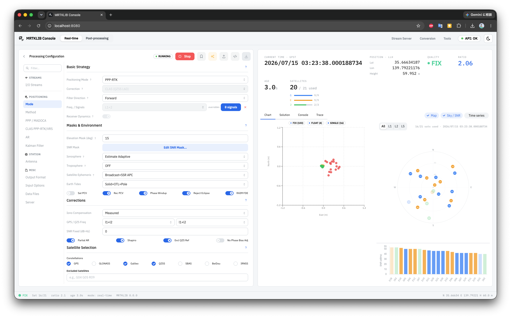

# MRTKLIB Web UI

MRTKLIB Web UI runs the [MRTKLIB](https://github.com/h-shiono/MRTKLIB) GNSS
tools from a browser. Everything is in one Docker container: post-processing,
real-time positioning, stream relay (including CLAS to RTCM3), receiver
configuration, RINEX conversion and data tools. Nothing needs to be compiled.

## Where to read what

Three sites cover MRTKLIB and this UI. Each does one job.

| Site | For | Read it for |
|---|---|---|
| [mrtklib-quickstart](https://github.com/h-shiono/mrtklib-quickstart) | First-time users | Getting a first solution, once |
| **This site** | People who use the UI in earnest | The screens, task guides, deployment, upgrades, supported hardware |
| [MRTKLIB documentation](https://h-shiono.github.io/MRTKLIB/) | Anyone choosing options | What each option and method means. The `?` icons in the UI's config panels open the matching page there. |

This site does not repeat the option reference. Where a page mentions an
option, it links to the MRTKLIB documentation.

## Start here

- [Install](getting-started/install.md): run the container and open the UI.
- [Screens](screens/index.md): what each part of the UI does.
- [Security and network access](deployment/security.md): before you open the
  UI to another machine.
- [Known issues and test status](reference/known-issues.md): what has and has
  not been checked on real hardware.

## Help and feedback

Bug reports and questions are welcome on
[GitHub Issues](https://github.com/h-shiono/mrtklib-docker-ui/issues),
including partial or unclear ones. Reports from real receivers and data sets
help most.
